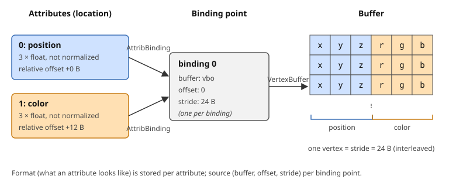
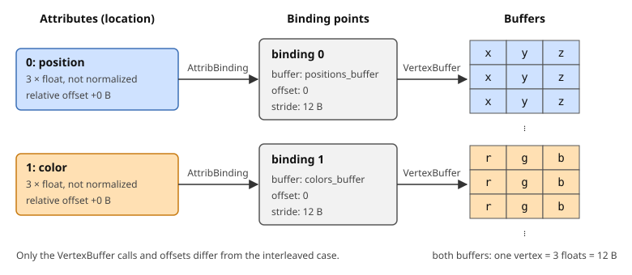

# Direct state access for vertex array objects

This note explains how a vertex array object (VAO) is set up with the _direct state access_ (DSA) functions of
OpenGL 4.5, why the DSA way is easier to reason about than the classic bind-to-edit way, and which mistakes it does not
protect you from. It accompanies the [Direct state access for the vertex array](README.md#direct-state-access-for-the-vertex-array)
part of the `06_Pyramid` assignment.

## What a VAO stores

A VAO is a container for the _vertex specification_: everything the vertex fetch stage needs to turn buffers into
shader inputs. It stores three kinds of state:

- **Attribute state** (per attribute index, i.e. shader `location`): whether the attribute is enabled, its format
  (number of components, type, normalization, offset inside the vertex) and the _binding point_ it reads from.
- **Binding point state** (per binding index): the buffer attached to this binding point, the offset of the first
  vertex in that buffer and the _stride_.
- **The element buffer**: the index buffer used by `glDrawElements`. There is exactly one per VAO.

It does **not** store the vertex data; the buffers do. It also does not store the program, the uniforms or the
`GL_ARRAY_BUFFER` binding (see [below](#the-gl_array_buffer-binding-is-not-vao-state)).

The split between attributes and binding points is the key idea of the 4.5 API:

<p align="center"></p>

Several attributes may read from the same binding point (an interleaved buffer, as above), and the stride is given once
for the binding, not once per attribute. The _format_ (what an attribute looks like) is separated from the _source_
(where the bytes come from).

## The classic (bind to edit) way

Before 4.5 the VAO was edited through the **currently bound** VAO and the **currently bound** `GL_ARRAY_BUFFER`:

```c++
glGenVertexArrays(1, &vao);
glBindVertexArray(vao);                       // (1) select the VAO to edit
glBindBuffer(GL_ARRAY_BUFFER, vbo);           // (2) select the buffer
glBindBuffer(GL_ELEMENT_ARRAY_BUFFER, ibo);   //     recorded in the VAO!

glEnableVertexAttribArray(0);
glVertexAttribPointer(0, 3, GL_FLOAT, GL_FALSE, 6 * sizeof(GLfloat), (void *) 0);
glEnableVertexAttribArray(1);
glVertexAttribPointer(1, 3, GL_FLOAT, GL_FALSE, 6 * sizeof(GLfloat), (void *) (3 * sizeof(GLfloat)));

glBindVertexArray(0);                         // (3) unbind, or the next edit hits this VAO
```

This works, but it is full of hidden state:

- Every call depends on what is bound at that moment, and nothing in the call shows it.
- `glVertexAttribPointer` silently reads `GL_ARRAY_BUFFER` and records the **buffer it finds there** in the VAO. The
  binding itself is not part of the VAO, but the association made by this call is.
- `GL_ELEMENT_ARRAY_BUFFER` is the opposite: the binding _is_ part of the VAO. Binding it with no VAO bound, or
  unbinding the VAO before it, gives surprising results.
- The last argument of `glVertexAttribPointer` is a byte offset disguised as a `void *`.
- Stride and buffer are repeated for every attribute.

## The DSA way

With DSA each function takes the VAO name as its first argument. Nothing is bound, so nothing depends on bind order, and
the call tells you which object it changes.

```c++
// Attribute locations, must match layout(location = ...) in the vertex shader.
constexpr GLuint POSITION_LOCATION = 0;
constexpr GLuint COLOR_LOCATION = 1;
// The binding point both attributes read from.
constexpr GLuint VERTEX_BUFFER_BINDING = 0;

GLuint vao;
OGL_CALL(glCreateVertexArrays(1, &vao));                                                      // (1)

OGL_CALL(glVertexArrayVertexBuffer(vao, VERTEX_BUFFER_BINDING, vbo, 0, 6 * sizeof(GLfloat))); // (2)
OGL_CALL(glVertexArrayElementBuffer(vao, ibo));                                               // (3)

OGL_CALL(glEnableVertexArrayAttrib(vao, POSITION_LOCATION));                                  // (4)
OGL_CALL(glVertexArrayAttribFormat(vao, POSITION_LOCATION, 3, GL_FLOAT, GL_FALSE, 0));        // (5)
OGL_CALL(glVertexArrayAttribBinding(vao, POSITION_LOCATION, VERTEX_BUFFER_BINDING));          // (6)

OGL_CALL(glEnableVertexArrayAttrib(vao, COLOR_LOCATION));
OGL_CALL(glVertexArrayAttribFormat(vao, COLOR_LOCATION, 3, GL_FLOAT, GL_FALSE, 3 * sizeof(GLfloat)));
OGL_CALL(glVertexArrayAttribBinding(vao, COLOR_LOCATION, VERTEX_BUFFER_BINDING));
```

1. Creates the object. See [`glGenVertexArrays` with DSA functions](#glgenvertexarrays-with-dsa-functions).
2. Attaches buffer `vbo` to the binding point, starting at byte offset `0`, with a stride of one vertex
   (`6 * sizeof(GLfloat)` bytes). The stride lives here, once.
3. Attaches the index buffer.
4. Attributes are disabled by default; enable each one used.
5. Describes the attribute: 3 floats, not normalized, at byte offset `0` (position) or `3 * sizeof(GLfloat)` (color)
   from the start of a vertex. The offset is a plain integer, _relative to the vertex_.
6. Connects the attribute to the binding point it reads from.

Drawing is unchanged: the VAO still has to be bound, because `glDraw*` uses the bound one.

```c++
OGL_CALL(glBindVertexArray(vao));
OGL_CALL(glDrawElements(GL_TRIANGLES, 18, GL_UNSIGNED_BYTE, nullptr));
OGL_CALL(glBindVertexArray(0));
```

> [!NOTE]
> DSA removes the need to bind in order to _edit_. Binding is still needed to _use_ the VAO. The same is true for the
> program (`glUseProgram`).

## Function mapping

| Classic                                                         | DSA                                                                   | Remark                                                                   |
|-----------------------------------------------------------------|-----------------------------------------------------------------------|--------------------------------------------------------------------------|
| `glGenVertexArrays`                                             | `glCreateVertexArrays`                                                | `Create` makes the object right away, `Gen` only reserves the name.      |
| `glBindBuffer(GL_ELEMENT_ARRAY_BUFFER, b)`                      | `glVertexArrayElementBuffer(vao, b)`                                  | No target; one index buffer per VAO.                                     |
| `glBindBuffer(GL_ARRAY_BUFFER, b)` + `glVertexAttribPointer`    | `glVertexArrayVertexBuffer(vao, binding, b, offset, stride)`          | Buffer, offset and stride go to the binding point.                       |
| `glEnableVertexAttribArray(i)`                                  | `glEnableVertexArrayAttrib(vao, i)`                                   | Note the different word order. Also `glDisableVertexArrayAttrib`.        |
| `glVertexAttribPointer(i, size, type, norm, stride, ptr)`       | `glVertexArrayAttribFormat(vao, i, size, type, norm, relative_offset)` | Floating point attributes. No stride, no buffer; offset is an integer.   |
| `glVertexAttribIPointer`                                        | `glVertexArrayAttribIFormat`                                          | Integer attributes (`int`, `uint`, `ivec*` in the shader).               |
| `glVertexAttribLPointer`                                        | `glVertexArrayAttribLFormat`                                          | `double` attributes.                                                     |
| (implicit: attribute `i` reads from the buffer given to `glVertexAttribPointer`) | `glVertexArrayAttribBinding(vao, i, binding)`        | New step: connect the attribute to a binding point.                      |
| `glVertexAttribDivisor(i, d)`                                   | `glVertexArrayBindingDivisor(vao, binding, d)`                        | Instancing: the divisor belongs to the _binding_, not to the attribute.  |

## Pitfalls

The first two do not produce an OpenGL error. If nothing is drawn or the colors are wrong, check them first.

- **Forgetting to enable an attribute.** A disabled attribute is not read from the buffer. The shader receives the
  constant "current" value, `(0, 0, 0, 1)`. The classic `glEnableVertexAttribArray` is also easy to mix up with the DSA
  `glEnableVertexArrayAttrib`; the former acts on the bound VAO, so left in the code it modifies whichever VAO happens
  to be bound, or generates `GL_INVALID_OPERATION` if none is.

- **Forgetting `glVertexArrayAttribBinding`.** By default attribute `i` reads from binding point `i`. If everything
  lives in binding `0`, attribute `0` works by accident and attribute `1` reads from the (empty) binding `1`. Always
  connect the attributes explicitly.

- **`glGenVertexArrays` with DSA functions.** `glGenVertexArrays` only reserves a name; the VAO object comes into being
  when it is first bound. A DSA function called with such a name generates `GL_INVALID_OPERATION`. Use
  `glCreateVertexArrays`.

- **Offset versus stride.** The `relative_offset` of `glVertexArrayAttribFormat` is the offset inside one vertex. The
  offset in `glVertexArrayVertexBuffer` is the offset of the first vertex inside the buffer. Both are in bytes. The
  stride is only in the latter, and a stride of `0` there does **not** mean "tightly packed" as it did in
  `glVertexAttribPointer`; it means every vertex reads the same data. Always pass the real size of a vertex.

- **Mixing the two styles.** Calling `glBindBuffer(GL_ARRAY_BUFFER, ...)` and `glVertexAttribPointer` on a VAO that was
  also set up with the DSA calls is legal, since both styles edit the same state, but it makes the code unreadable and
  the bindings hard to follow. Do not mix them in one VAO.

- **The `GL_ARRAY_BUFFER` binding is not VAO state.** With DSA you never need it for vertex setup. (Buffers are filled
  with `glNamedBufferData` and `glNamedBufferSubData`, which also ignore it.) Only the `GL_ELEMENT_ARRAY_BUFFER` binding
  is stored in the VAO, and `glVertexArrayElementBuffer` sets it without touching the binding point.

## Case study: several buffers

Because format and source are separate, an attribute layout with a separate buffer per attribute is natural and needs no
change in the format calls, only in the binding points:

<p align="center"></p>

```c++
constexpr GLuint POSITION_BINDING = 0;
constexpr GLuint COLOR_BINDING = 1;

glVertexArrayVertexBuffer(vao, POSITION_BINDING, positions_buffer, 0, 3 * sizeof(GLfloat));
glVertexArrayVertexBuffer(vao, COLOR_BINDING,    colors_buffer,    0, 3 * sizeof(GLfloat));

glEnableVertexArrayAttrib(vao, POSITION_LOCATION);
glVertexArrayAttribFormat(vao, POSITION_LOCATION, 3, GL_FLOAT, GL_FALSE, 0);
glVertexArrayAttribBinding(vao, POSITION_LOCATION, POSITION_BINDING);

glEnableVertexArrayAttrib(vao, COLOR_LOCATION);
glVertexArrayAttribFormat(vao, COLOR_LOCATION, 3, GL_FLOAT, GL_FALSE, 0);
glVertexArrayAttribBinding(vao, COLOR_LOCATION, COLOR_BINDING);
```

Switching a mesh between the interleaved and the separate layout changes only the `glVertexArrayVertexBuffer` calls and
the offsets. This is the reason the course uses named constants for locations and binding points instead of bare
numbers.

## Checklist

1. `glCreateVertexArrays`, not `glGenVertexArrays`.
2. `glVertexArrayVertexBuffer` for every binding point in use, with the real stride in bytes.
3. `glVertexArrayElementBuffer` if the mesh is indexed.
4. For every attribute: enable, format (offset relative to the vertex), binding.
5. Attribute locations match the `layout(location = ...)` qualifiers in the shader.
6. Bind the VAO before drawing; unbind afterwards if you want to be safe.
7. Wrap every call in `OGL_CALL`.
